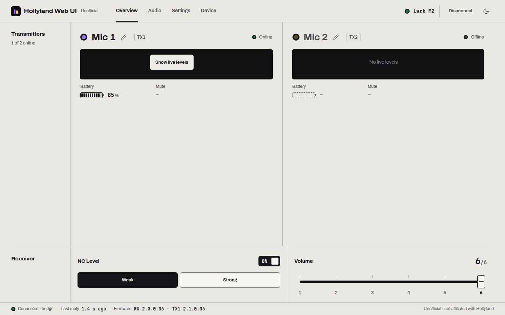

# Hollyland Web UI

Hollyland Web UI is a control panel for Hollyland LARK A2, A2S, M2 and M2S wireless microphone receivers. It
runs in the browser. Plug the receiver into a computer by USB to change its settings, see the state of
each mic, watch levels, record and add voice effects.

> **Unofficial.** Hollyland Web UI is an independent project. It is not affiliated with, endorsed by or
> supported by Hollyland. LARK and HollyAudio are trademarks of their owners.

**Ways to run it:**

- Open **<https://khromov.github.io/hollyland-web-ui/>** in Chrome, Edge or Opera on a desktop or laptop.
- Run **`npx hollyland-web-ui`**, which starts the web UI and, on macOS and Linux, the USB bridge. *Coming soon: the
  package isn't on npm yet.*
- Run it from a clone of this repository (see [Development](#development)).

## Features

- **Receiver settings:**
  - Noise cancellation, on/off and level
  - Output volume, plus volume lock on camera receivers
  - Channel mode: mono, stereo, or safety track on the A2
  - Bel canto voice preset (A2)
  - Indicator light
  - Mic recognition
- **More settings** (depends on the receiver):
  - Smart battery life
  - Mic auto power-off
  - External speaker without unplugging
  - M2S custom button functions
- **Status of each mic:** online, battery, charging and mute (A2/A2S), all refreshed every 1 to 3 seconds.
- **Device page:**
  - Firmware versions and serial numbers of the receiver and both mics
  - Paired mics, with Remove Pairing
  - Factory reset (asks for confirmation)
- **Audio** (in the browser, from the receiver's USB audio):
  - Live level meters
  - WAV recording
  - Monitoring
  - Voice effects (see [Audio](#audio))
- **Developer console** (turn on in Settings): every packet sent and received, decoded.

Mic 1 is shown in purple and Mic 2 in yellow. On the LARK A2 these match the transmitters' LEDs when Mic Recognition is on.

## Supported receivers

| Receiver | USB ID | Status |
| --- | --- | --- |
| LARK A2 | `3547:0411` | Tested on hardware |
| LARK A2S (camera receiver) | `3547:0412` | Implemented from the official app, not yet tested on hardware |
| Lark M2 | `3547:0007`, `3547:0008` (EAGLESHERO `4417:0020`/`0021`) | Tested on hardware (macOS and Linux); the EAGLESHERO edition not yet |
| LARK M2S | `3547:0405`, `3547:0406` | Implemented from the official app, not yet tested on hardware |

The LARK A1 and LARK M3 use different protocols and are not supported. Some features need a minimum
receiver firmware. When a feature isn't available, the UI explains why.

**Good to know (LARK A2, tested on hardware):**

- **The button on a mic toggles noise cancellation.** It does not mute the mic. The Receiver card follows
  within a second when the connection is live.
- **Turning noise cancellation on brings back the last level used**, for example Weak.
- **A mic in the charging case shows as not connected.**
- **The mute indicator is read-only.** There is no known command to mute an A2 mic, so Hollyland Web UI can't
  change it.

## Platforms

Hollyland Web UI talks to the receiver over **WebHID**. WebHID works in Chromium browsers (Chrome, Edge, Opera,
Brave and others) on desktop and laptop computers. Safari, Firefox and phone browsers don't have it.

| Computer | In the browser | With the local bridge |
| --- | --- | --- |
| **Linux** | **Write-only** (tested with a Lark M2) | **Full live control** (tested with a Lark M2). USB audio keeps working. Runs without sudo with the udev rules below. |
| **ChromeOS** | Write-only (expected: same kernel HID stack as Linux, not yet tested) | Not available |
| **macOS** | **Write-only** (tested) | **Full live control** (tested). The receiver's USB audio pauses while the bridge runs. |
| **Windows** | Write-only (expected, not yet tested) | Not available |

**Write-only** means the page can send settings to the receiver but can't read anything back: no battery
levels, no mic status and no current values. The receiver answers every request, but its replies use an HID
report ID that its descriptor doesn't declare, and macOS and Linux (and very likely Windows) discard them
before the browser sees them. On Linux the kernel's HID core drops an input report with an undeclared ID
before it reaches hidraw, the device node Chrome reads. Settings you send do take effect; on macOS this was tested with the indicator light and
channel mode. The controls show the values this browser last sent. The A2's noise-cancellation on/off switch
is hidden in this mode because the receiver only offers a toggle, and a toggle without the current state
could do the opposite of what you asked. You can still choose a level.

The **local bridge** is a small helper that runs on your computer. It takes the receiver's HID control
interface with libusb and relays its packets to the page over `ws://127.0.0.1`.

- **macOS:** it runs as root, and macOS can only hand over the whole USB device, so **the receiver's USB audio
  is unavailable while the bridge runs** and comes back when you stop it.
- **Linux:** it takes only the HID interface, so **USB audio keeps working**. It runs as you, without sudo,
  and needs the udev rules below to open the receiver.

See [docs/BRIDGE.md](docs/BRIDGE.md).

Linux udev rules: the first line lets Chrome open the receiver (WebHID), the second lets the bridge open it
without root. `3547` is Hollyland's USB vendor ID, `4417` that of the EAGLESHERO edition.

```
SUBSYSTEM=="hidraw", ATTRS{idVendor}=="3547|4417", MODE="0660", TAG+="uaccess"
SUBSYSTEM=="usb", ATTR{idVendor}=="3547|4417", MODE="0660", TAG+="uaccess"
```

Save them as `/etc/udev/rules.d/70-hollyland.rules`, run `sudo udevadm control --reload`, then re-plug the
receiver.



## Ways to use it

### 1. Hosted: <https://khromov.github.io/hollyland-web-ui/>

Nothing to install.

1. Open the page in Chrome, Edge or Opera.
2. Press **Connect receiver** and choose "Wireless Microphone".

On its own the connection is write-only: the page sends settings but can't read them back.

For full control on macOS or Linux with the hosted page, start only the bridge with `npx hollyland-web-ui --bridge-only`
(once the package is on npm). Until then, run it from a clone of this repository, after `npm install`:

```
npm run bridge -- --allow-origin https://khromov.github.io
```

Then open <https://khromov.github.io/hollyland-web-ui/?bridge=auto>, or press **Connect through local
bridge**. Chrome asks whether the site may access apps and services on this device. Allow it, because the
bridge listens on 127.0.0.1. The bridge accepts the hosted page only when it is started for it, as above;
otherwise it accepts only pages served from this computer.

### 2. `npx hollyland-web-ui`

> **Coming soon.** The package is ready but not on npm yet, so these commands don't work today. Until it is
> published, run Hollyland Web UI from a clone (see [Development](#development)) and start the bridge with
> `npm run bridge`.

This needs [Node.js](https://nodejs.org/) 20 or newer.

```
npx hollyland-web-ui
```

- It serves the web UI on <http://127.0.0.1:47320> (this computer only) and opens it in your browser.
- **On macOS** it also starts the USB bridge, which asks for your password: only root can take a USB device
  away from macOS. The page connects through the bridge by itself and shows **Connected · bridge**.
  If you skip the password, Hollyland Web UI keeps running in write-only mode.
- **On Linux** it starts the bridge too, as you: it never uses sudo unless you add `--sudo`. It needs the
  [udev rules](#platforms) to open the receiver; without them it prints the rules and keeps waiting, so you
  can add them and re-plug the receiver. USB audio keeps working.
- Press **Ctrl+C** to stop. The bridge hands the receiver back (on macOS USB audio returns a moment later).

| Option | Meaning |
| --- | --- |
| `--no-bridge` | Don't start the bridge. The page uses WebHID, which is write-only on macOS and Linux. On macOS this keeps USB audio working. |
| `--bridge` | Start the bridge (it starts by default on macOS and Linux). |
| `--sudo` | Linux: start the bridge under sudo, for when the udev rules aren't installed. (On macOS it always uses sudo.) |
| `--bridge-only` | Start only the bridge, for the hosted page (in this mode it also accepts that page). Prints the address to open. |
| `-p`, `--port <n>` | Web UI port (default 47320). |
| `--bridge-port <n>` | Bridge port (default 47321). |
| `--no-open` | Don't open a browser; the address is printed. |
| `--verbose` | Print every USB packet the bridge relays. |
| `-v`, `--version` / `-h`, `--help` | Version / help. |

The bridge doesn't run on Windows. There, `npx hollyland-web-ui` serves the write-only web UI.

### 3. From a clone (development)

See [Development](#development).

## Audio

The **Audio** tab uses the receiver as an ordinary USB microphone through `getUserMedia`. It works without a
control connection, and also on macOS and Windows in write-only mode.

- **Level meters** for each mic.
- **Recording** to WAV:
  - Source: the raw input or the input with effects
  - Layout: one stereo file or one file per mic
  - Bit depth: 16-bit, 24-bit or 32-bit float
  - Takes stay in the page until you download them.
- **Monitoring** through this computer's output. Use headphones.
- **Voice effects:** the 8 voice profiles from the HollyAudio app, such as Clean Voice, Vocal Boost and Warm &
  Solid. Choose one for each mic, or link the two. They run in an AudioWorklet that uses a TypeScript port of
  the app's DSP library (EQ, compressor, de-esser, exciter, loudness). In the parity tests its output matches
  the native library bit for bit; see [docs/dsp/parity-report.md](docs/dsp/parity-report.md). The effects add
  4.7 ms of delay.

Audio is unavailable while the local bridge holds the receiver on macOS (see [Platforms](#platforms)).

## How it works

- **Control channel:** the receiver's control channel is HID interface 0, with 64-byte interrupt reports in
  each direction.
- **Requests:** `AA DD cmd dst lenHi lenLo payload…`, where `dst` is `0x40` for the receiver and
  `0x41`/`0x42` for the mics.
- **Replies:** `BB DD cmd src lenHi lenLo payload…`.
- **No ceremony:** there is no handshake, no checksum and no notifications.
- **Polling:** the page polls a heartbeat (`0x10`) every second, or every 3 s on the Lark M2. The heartbeat
  carries link state, battery and every setting, so changes made on the hardware show up within a second.
- **Settings:** each setting is a single command that the receiver acknowledges.

The protocol was worked out from the official HollyAudio apps for Android and iOS and checked against a live
LARK A2. [docs/PROTOCOL.md](docs/PROTOCOL.md) is the full specification: framing, the command catalogue for each
model, heartbeat layouts, platform behaviour and what has been verified on hardware.

| Code | Contents |
| --- | --- |
| `src/lib/protocol/` | Transports (WebHID, bridge, mock), framing, commands, model registry, `HollylandDevice` |
| `src/lib/audio/`, `src/lib/dsp/` | Web Audio engine, WAV writer, voice-effects worklet and the DSP port |
| `src/components/`, `src/lib/ui/` | Svelte 5 UI |
| `scripts/` | Local USB bridge, read-only probe CLI (`node-hid`) |
| `cli/` | The `npx hollyland-web-ui` launcher |
| `docs/` | Protocol specification, bridge, DSP notes and research |

## Firmware updates

Firmware updates are **not supported** and won't be. A failed update can brick a receiver or a mic, and the
firmware images come from Hollyland's servers. Use the official HollyAudio app to update. Hollyland Web UI shows
the installed versions on the Device page.

## Privacy

Everything runs on your computer. There are no accounts, no analytics and no server: the hosted version is
static files, and the bridge listens only on 127.0.0.1. Device traffic and audio stay in your browser.
Recordings are saved only when you download them. Your theme, the developer-mode switch and the values last
sent in write-only mode are kept in your browser's local storage.

## Development

This needs Node.js 20 or newer (CI uses 24).

```
git clone https://github.com/khromov/hollyland-web-ui.git
cd hollyland-web-ui
npm install
npm run dev          # http://localhost:5173
```

| Command | What it does |
| --- | --- |
| `npm run dev` | Vite dev server |
| `npm test` | Unit tests (vitest): protocol, bridge relay, DSP, CLI |
| `npm run check` | svelte-check and TypeScript for the app, Node config and scripts |
| `npm run build` | Production build in `dist/`. `BASE_PATH=/hollyland-web-ui/` builds for GitHub Pages. |
| `npm run bridge` | Local USB bridge (asks for your password on macOS; runs as you on Linux; see [docs/BRIDGE.md](docs/BRIDGE.md)) |
| `npm run probe -- <cmd>` | Read-only protocol probe over `node-hid` (`list`, `status`, `sweep`, …) |
| `npm run build:cli` | Builds the npm package's web UI and bundled bridge into `cli/dist/` (`npm pack` runs it too) |
| `npm run dsp:prepare`, `npm run dsp:compare` | DSP parity harness against the native library. Needs the HollyAudio iOS app on an Apple Silicon Mac. |

**Simulator.** The dev server can fake a receiver, so you can work on the UI without hardware. Add one of
these to the URL:

- `?mock=a2`
- `?mock=a2s`
- `?mock=blind` (an A2 in write-only mode)
- `?mock=m2`
- `?mock=m2s`
- `?mock=m2scam`

Example: <http://localhost:5173/?mock=a2>. The simulator is left out of production builds.

**Deploys.** Every push to `main` runs tests and type checks and publishes the site to GitHub Pages
(`.github/workflows/pages.yml`).

**The npm package.** `npm pack` builds `cli/dist/` and packs it. To try the package locally, run
`npx --package=./hollyland-web-ui-<version>.tgz hollyland-web-ui`.

## Legal

- Hollyland Web UI is an independent, unofficial project. It is not affiliated with, endorsed by or supported by
  Hollyland.
- The protocol and DSP behaviour were studied for interoperability. This repository doesn't contain
  Hollyland's apps, libraries or firmware.
- Hollyland Web UI sends the same commands as the official app. Using it is at your own risk.
- Factory reset and Remove Pairing always ask for confirmation first.

Released under the [MIT License](LICENSE).
